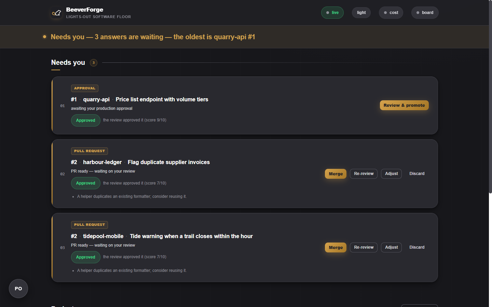
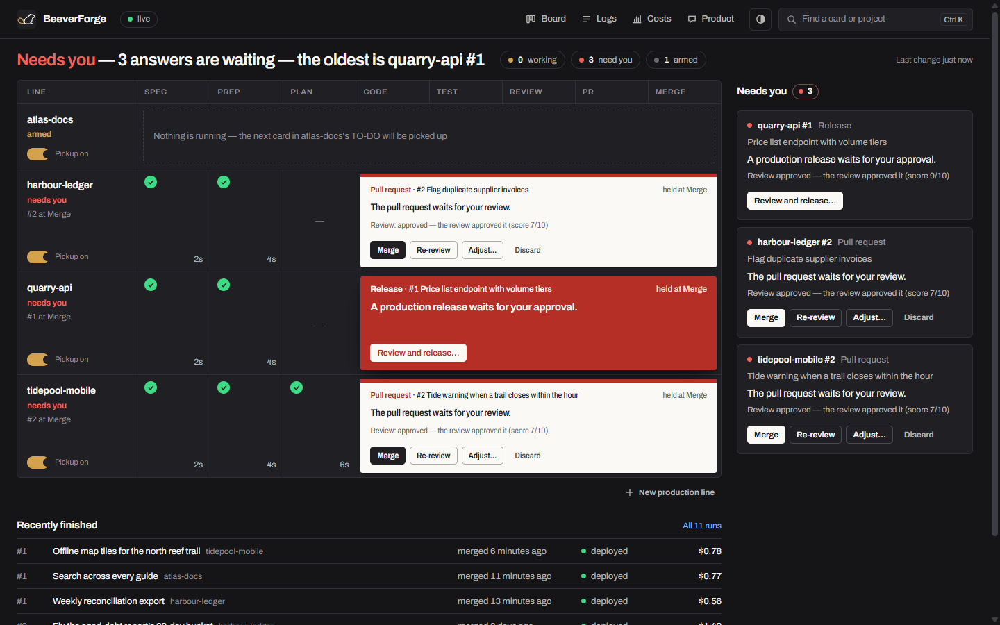
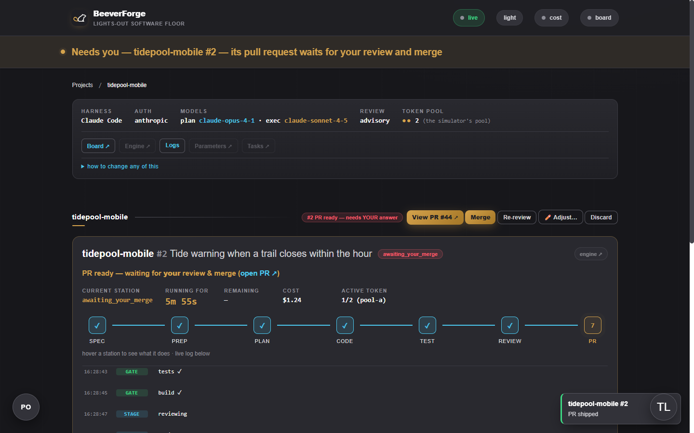
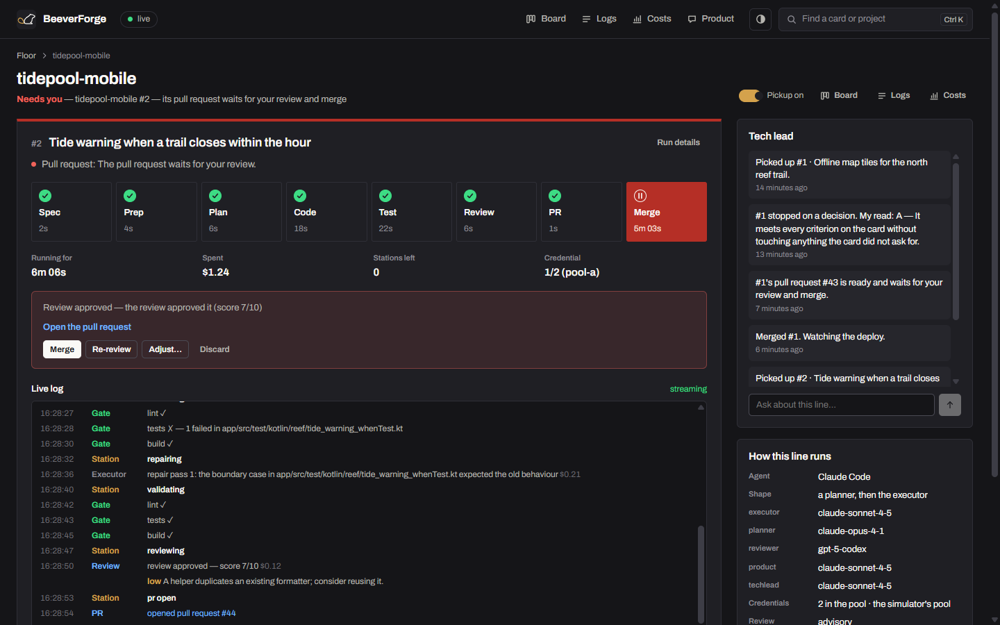
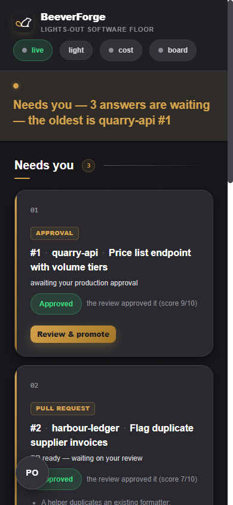
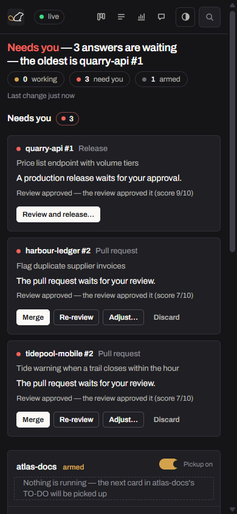

# The default panel and the new panel, side by side

Both panels were measured on the **same live floor at the same time**: the rig's API, with the
factory simulator answering for the engine and the worker (see [README.md](README.md)). The default
panel was opened at `http://127.0.0.1:8790/`, served by the API exactly as it ships; the new panel at
`http://127.0.0.1:5173/`. `node scripts/compare.mjs` repeats every measurement below; the figures
here are one run of it, each page watched for 60 s after it settled. The axe counts move a little
with what is on the floor at that moment, because they count elements.

## What it looks like

| | the default panel | the new panel |
|---|---|---|
| the floor |  |  |
| one line |  |  |
| a phone, 390 px |  |  |

## What was measured

| | the default panel | the new panel |
|---|---|---|
| API requests in a minute of steady state, on the floor | **51** — `/api/floor` 33, coordinator 10, inbox 4, jobs 3, budget 1 | **2** — the tech lead's narration, a 30 s backstop |
| … on a line's page | **23** — coordinator 10, inbox 4, jobs 3, the line's floor 3, and 3 more | **2** |
| why | fixed timers (6 s, 15 s, 20 s, 60 s) run whatever the streams do, and every engine frame re-reads the floor | streams write into the cache; the reads the server derives from the jobs are asked once per change; timers run only while a stream is down |
| what needs you, after it changes | on the next 15 s inbox poll | asked again on the engine frame that changed it |
| axe, serious and critical, the floor | colour contrast ×12, label/name mismatch ×5 | none |
| axe, a line's page | colour contrast ×6, label/name mismatch ×1 | none |
| what loads first | one 408 KB file (131 KB gzip): every surface's code and styles | 140 KB gzip of JavaScript, 7 KB of CSS and the bundled font (90 KB, Latin) for the floor — more than the default page on a first visit, cached after it; the board, logs, costs and product room load when opened (5–19 KB gzip each); the ⌘K bar and the motion engine load after the first paint |
| requests to another host | Chart.js from a CDN when the cost dashboard opens | none — the font is bundled and served with the page; charts are drawn in SVG |
| phone, 320–414 px | the floor fits; the confirm dialog is wider than a 375 px screen | no horizontal overflow on any page (end-to-end checked) |

## What a person sees differently

| question | the default panel | the new panel |
|---|---|---|
| Is the factory moving? | one sentence, then a list of what needs you; the lines are below the fold as project tiles | the same sentence, then **every line at once**: each live card sits in the pigeonhole of the station it is at, the time each station took, and the card travels to the next slot as the engine says it moved |
| What needs me, and where do I answer? | a list on the index; buttons on the project page; a modal opens by itself for a new decision | the oldest ask is the screen's one red plate, on the card itself, with its answers; every other ask is flagged on its card and listed in Needs you with the same answers — nothing opens by itself |
| Did my click land? | a toast after the request returns | the card says what it is doing at once ("Merging…") and clears when the engine's next frame for that job confirms it; a refusal is the server's sentence |
| What is the line doing this second? | the project page's live log | the card on the floor shows the newest line of its log; the line page streams the whole log and follows it until you scroll up |
| Is what I see current? | "live" pill; a stale floor after 45 s without an answer | the same rule, said where the floor is: "Last change 12 s ago" while live, "Not live — last read 1 min ago" when the stream is down |
| Loading | text ("loading…", "reading the floor…") and two shimmering bars | shapes that match what lands (cabinet rows, cards, tables), the previous data kept while it refreshes, no layout jump |

## Parity

Everything the default panel does is here, built on the same routes, except where the last column
says otherwise.

| area | in the new panel |
|---|---|
| the floor's verdict, its census, the "also" causes, the build-split banner, the live/reconnecting state | yes |
| what needs you: decisions, merge gates (merge, re-review, adjust, address comments, discard), production approval, usage-limit pauses, held cards (resume, skip), wedged jobs (stop) | yes, with the server's options |
| projects: pickup switch, scan TO-DO now, register a new project with the address read back | yes |
| a line: live stations and timings, live log, cost, the credential in use, the merge gate, the cockpit, every run with search and paging, the run briefing | yes |
| the tech lead: its conversation, its questions with options, its staged action, asking it something; its narration as notifications | yes |
| the board: columns from the server, drag and keyboard moves, the card drawer, the card form with pickup's live verdict, close / remove / reopen with a reason, the thread and comments, pull requests with their diff and merge, previews | yes |
| logs: every run from the journals, search, filter by state, live tail, show all | yes |
| costs: filters, totals, spend per day, by model and harness, autonomy, the knowledge-map A/B, the task table | yes, sortable |
| the product room: the project room and your own conversations (new, rename, delete), the conversation with staged proposals, attachments, requirements (accept, drop, break down, ask), what is waiting on you, documents, cards (triage, what is waiting), the system map | yes |
| sign-in: a token form instead of a browser prompt, the login page redirect, sign out, a product-only credential sent to the product room | yes |
| the old URLs (`/p/<project>/card/<ref>`, `/pr/<ref>`, `/preview/<ref>`, `/logs/...`, `/product/<project>`) | yes, redirected into the board where they moved |
| served by the API itself | **not yet** — see README, "Not done" |
| the read-only board for a product-only credential | **not yet** — it opens the product room |

## Defects of the default panel found while reading it, not carried over

1. The census line and the "+N more" row never render: the page reads `censusLine` and `alsoMore`,
   the server sends `census_line` and `also_more`.
2. Project names and issue numbers reach four request paths unencoded.
3. Toasts are not announced, and every overlay shares one `z-index`, so stacking is DOM order.
4. Mounting the tech-lead widget removes the product-owner dock, and its timer outlives the page.
5. A handful of strings are Portuguese in an English page.
